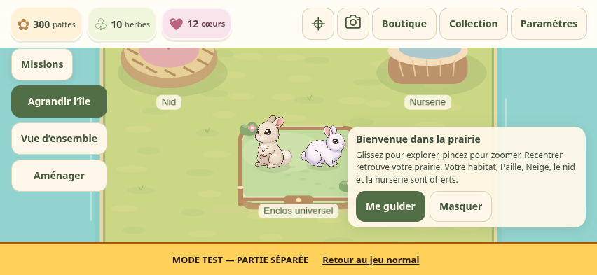
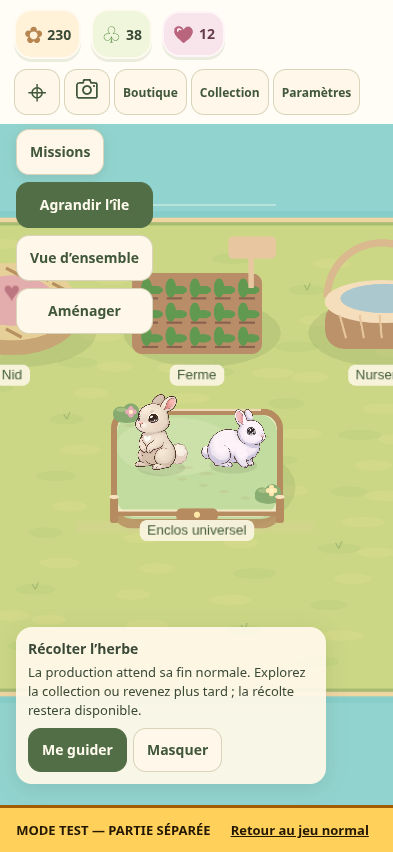
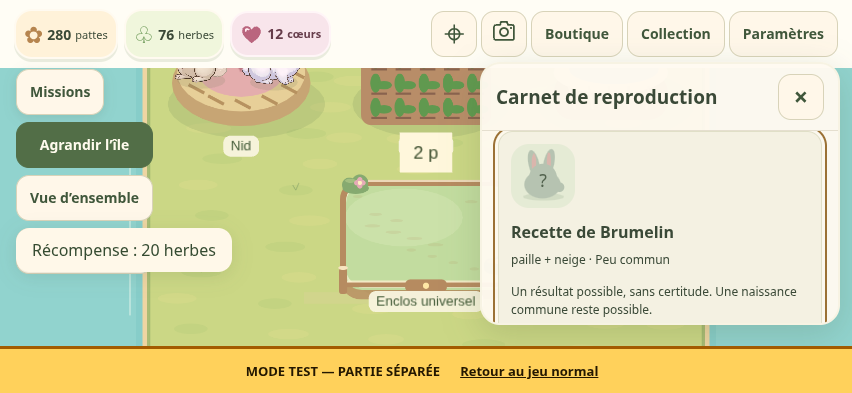
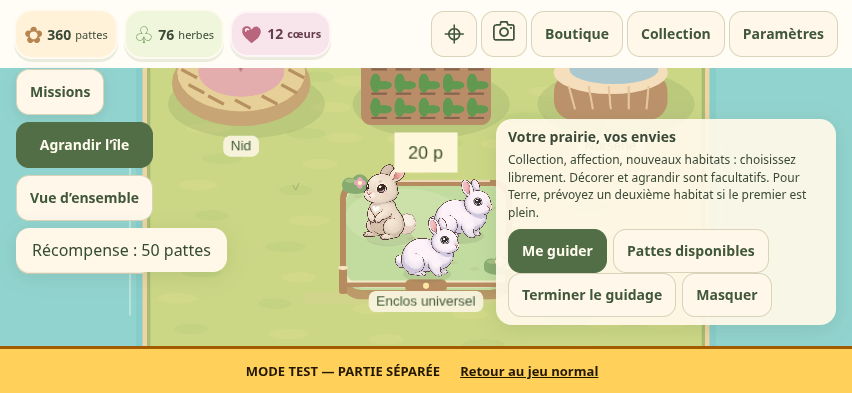
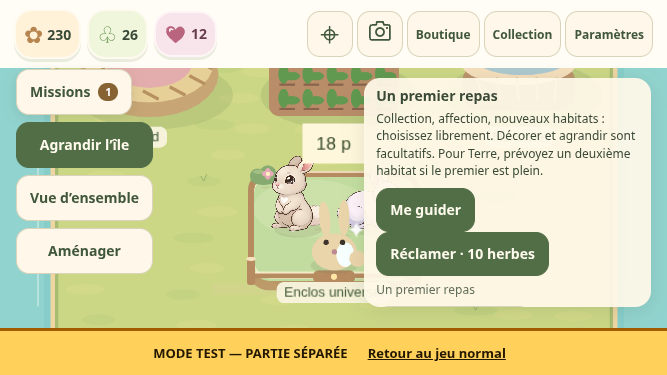

> Depuis l’étape 4 : [départ Paille seul, achats guidés Neige et budget](game-design.md#étape-4--départ-paille-seul). Le parcours décrit plus bas reste celui des parties créées auparavant, conservé sans récompense rétroactive.

> Mise à jour : [aides d’initiation facultatives et première naissance](initiation-aids.md). Les délais normaux, le transfert manuel et les probabilités restent inchangés.

# Début guidé facultatif

Révision applicative : `251391c1ae16b7b1a5453be53ac8cfdb636f1848`. [Jeu normal](https://sullivanlegoff-code.github.io/Project-L/) · [Laboratoire](https://sullivanlegoff-code.github.io/Project-L/dev/)

Historique de la première livraison du guidage, avant les aides facultatives : elle reprend `production` après les missions (`ff8966c`, documentation `b758799`). Elle ajoute le guidage, sans aides d’initiation ni changement des délais, revenus, coûts ou probabilités. La sauvegarde de jeu reste v8.

Le parcours va de la caméra/Recentrer à l’accueil : fiche et repas de Paille, ferme, petite production, collection pendant l’attente, récolte, repas de Neige, parents Paille/Neige au nid, recette de Brumelin, transfert manuel vers la nurserie, croissance puis accueil. Une naissance commune suffit. Brumelin n’est jamais promis.

« Me guider » ouvre un panneau ou recentre ; le joueur effectue chaque commande. La carte propose une récompense principale prête par `claimMainMission`, sans récompense supplémentaire. La mission réclamée disparaît de la liste active. Les objectifs et événements des missions restent distincts des préférences d’interface du guidage. Une action faite en avance compte ; une reprise ne dépend pas d’un panneau ouvert.

Le guidage se masque à tout moment et se reprend depuis Paramètres. Les anciennes parties ne l’activent pas automatiquement ; un import ne l’impose pas. Les nouvelles parties et le scénario explicite « Début guidé — nouvelle partie, délais normaux » proposent l’introduction. Le scénario utilise exactement les ressources de départ et ne distribue rien en plus.

Nourrir augmente l’affection, sans faim ni entretien. Si l’herbe manque, le guidage propose la ferme, sans lancer de production. La suggestion de récolte de pattes n’apparaît qu’avec au moins une patte réellement disponible. L’accentuation des commandes est statique, sans animation de tutoriel. En paysage, la carte reste à droite pour préserver les commandes de prairie à gauche ; elle se masque pendant les panneaux.

Après l’accueil, collection, affection et habitats deviennent des pistes parallèles ; décorations et extension sont facultatives. Pour Terre, le texte suggère un deuxième habitat si le premier est plein. La fin du guidage ne déclenche aucune série de fenêtres.

## Vérification

Les tests ciblés couvrent : fermeture de fiche et reprise, réclamation unique, consultations anticipées, import sans activation imposée, absence de ressources, délais normaux et interruption par sérialisation, naissance commune et Brumelin avec tirages contrôlés **uniquement dans les tests**. Les règles de jeu et les illustrations sont conservées.

Le parcours Chromium tactile utilise les boutons réels et le portefeuille initial, sans injection de ressources ni tirage contrôlé. Les attentes de 5 minutes, 20 minutes puis croissance sont avancées explicitement par l’horloge du laboratoire : ce contrôle vérifie la simulation, pas un temps humain observé ni un essai Safari physique. Il couvre aussi la rotation portrait/paysage, la collection, le carnet, le transfert manuel, sept réclamations et l’isolation du jeu normal. Les preuves sont conservées dans [validation/guided-start](validation/guided-start). Les cinq captures ci-dessous proviennent des builds locaux du code final ; le contrôle HTTPS réel est enregistré séparément.

## Essai iPhone

Utiliser le laboratoire et son scénario « Début guidé » pour préserver la partie normale ; les boutons d’horloge servent uniquement au test. Dans le jeu normal, laisser passer les délais habituels.

1. Glisser/pincer, utiliser Recentrer puis « Me guider » pour la fiche Paille ; fermer et rouvrir.
2. Nourrir Paille jusqu’à 2, fermer et réclamer les 10 herbes depuis la carte.
3. Acheter/placer une ferme, réclamer sa mission et lancer la petite production.
4. Ouvrir la collection avec « Me guider », fermer, tourner l’iPhone puis interrompre/reprendre le jeu.
5. Après 5 minutes, récolter et réclamer ; nourrir Neige jusqu’à 2 et réclamer.
6. Choisir Paille/Neige au nid, lancer gratuitement et consulter la recette de Brumelin pendant l’attente.
7. Après 20 minutes, transférer manuellement ; vérifier le retour des parents et le début de croissance.
8. Après croissance (5 minutes pour un commun, 15 pour Brumelin), accueillir et réclamer, même avec une espèce déjà connue.
9. Consulter les objectifs libres, terminer le guidage puis vérifier qu’il reste masqué après rechargement ; Paramètres permet de le reprendre.

## Livraison et preuves

- [CI des règles et interactions](https://github.com/sullivanlegoff-code/Project-L/actions/runs/38088628704) : 668 tests / 23 fichiers, TypeScript, deux builds, neuf suites sur les sources et onze suites sur les builds / 39 contrôles.
- [Publication finale](https://github.com/sullivanlegoff-code/Project-L/actions/runs/38089884666) : 668 tests, TypeScript, quatre builds et onze suites sur les URLs publiques / 40 contrôles sans erreur. Le contrôle supplémentaire couvre les actions anticipées avec récompenses en attente sur petit paysage 667 × 375.
- La correction finale limite la hauteur de la carte et permet de la faire défiler : la navigation reste accessible même avec plusieurs récompenses en attente. Elle concerne deux règles CSS et le scénario de contrôle ; aucun changement des règles du jeu.
- Normal et laboratoire servent `251391c`, format v8. Les prévisualisations Comptes (`3e70d9e`, v4) et Décorations (`85fe255`, v5) sont conservées. Comptes/Supabase restent en pause.
- [publication.json](validation/guided-start/publication.json), [public-browser.json](validation/guided-start/public-browser.json), [ci.json](validation/guided-start/ci.json), [final-local.json](validation/guided-start/final-local.json) distinguent la CI, le contrôle local et la publication réelle. [preserved-scope.json](validation/guided-start/preserved-scope.json) conserve les empreintes Git de 31 fichiers de règles, sauvegardes, caméra et illustrations inchangés.

## Captures

[Captures et rapports des URLs publiques](https://github.com/sullivanlegoff-code/Project-L/actions/runs/38089884666/artifacts/11683467640) — artefact conservé 30 jours. Les images ci-dessous restent conservées dans le dépôt.

Captures Chromium tactile des builds normal/laboratoire locaux du code final. Les délais ont été avancés dans le laboratoire ; elles ne constituent pas un test physique Safari ni une mesure du temps d’un joueur.

Accueil en paysage, avec les commandes de prairie accessibles :

Attente de la production après rotation en portrait :

Recette de Brumelin, identifiée sans promesse de résultat :

Accueil terminé et objectifs libres :

Actions anticipées et récompenses en attente, sur petit paysage :

