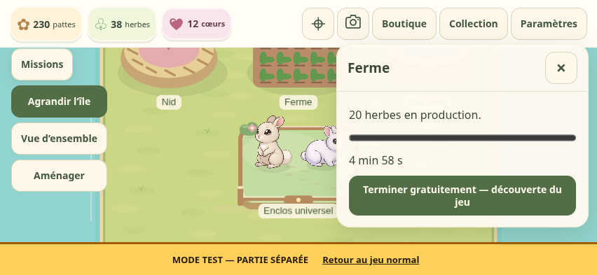
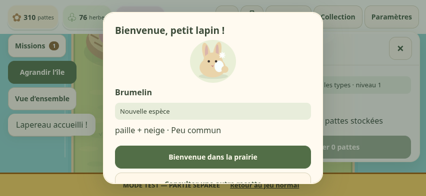

# Aides d’initiation et première naissance

Révision applicative publiée : `f2c3ad9f360c317c7bcd7e72644ade5d5af98468`. [Jeu normal](https://sullivanlegoff-code.github.io/Project-L/) · [Laboratoire](https://sullivanlegoff-code.github.io/Project-L/dev/).

Trois aides facultatives et gratuites accompagnent le début guidé des nouvelles parties : première petite production, première reproduction et croissance de son résultat. Le compte à rebours reste visible et le bouton « Terminer gratuitement — découverte du jeu » termine uniquement ce travail. Récolte, transfert et accueil sont manuels. Aucun cœur, revenu artificiel, nouveau tirage ou découverte anticipée.

Les droits font partie de la sauvegarde v8, dans une extension optionnelle `initiation`. Chaque cible conserve le bâtiment, l’étape, le début, la fin et la recette ou l’identité du résultat. Une croissance ne peut être liée qu’au résultat de cette reproduction. Les aides consommées et fermées persistent à l’export, à l’import du même état et au rechargement ; rouvrir le guidage ne les renouvelle pas. L’attente normale ou une accélération en cœurs ferme également l’aide du travail concerné. Une cible remplacée n’est jamais reportée sur le travail suivant. Un refus ne consomme pas l’aide. Le contrôleur enregistre la transaction avant de valider l’accélération gratuite.

Les anciennes sauvegardes restent v8, avec les mêmes bâtiments, ressources, réclamations et travaux. L’absence de l’extension signifie absence de droits : aucune aide n’est attribuée automatiquement aux anciennes parties, même en rouvrant leur guidage. Aucune remise à zéro ni migration de positions.

Les cœurs permettent aussi de terminer certains délais. Tu peux toujours attendre. Le tarif et les confirmations des accélérations normales sont conservés.

L’accueil réussi de la première naissance d’une nouvelle partie affiche une courte fenêtre avec le portrait existant, le nom et les types. « Nouvelle espèce » apparaît uniquement si l’espèce était inconnue juste avant l’accueil. Un commun propose le carnet de Brumelin ; Brumelin propose une autre recette. Une fermeture ou un rechargement ne rejoue pas la célébration : elle accompagne la commande d’accueil réussie, dont l’événement est persisté atomiquement. Pas d’illustration nouvelle ni d’animation ajoutée ; le son de réussite existant respecte le réglage de son.

## Laboratoire

- **Initiation — trois aides inutilisées** : vraie partie neuve, ressources initiales inchangées et trois droits disponibles.
- **Initiation — aide utilisée et croissance liée** : repas et reproduction via commandes réelles, aide du nid consommée, transfert manuel effectué, croissance du même résultat disponible. Recharger et rouvrir le guidage doit conserver ces droits.

Ces scénarios remplacent seulement la sauvegarde du laboratoire. Le premier ne force aucun résultat ; le second possède un résultat commun déterministe de fixture. Les contrôles navigateur du parcours neuf ne contrôlent jamais les tirages.

## Vérifications

Tests ciblés : cible exacte, résultat inchangé, absence d’avance globale d’horloge ou d’autres travaux, double pression, attente naturelle, cible absente/remplacée, import et rechargement, refus de sauvegarde, petite production et récolte manuelle, nurserie occupée et transfert manuel, tarif des cœurs, naissance commune et découverte de Brumelin. Parcours tactile Chromium avec rotation, sortie/reprise du guidage et conservation des aides. Le parcours historique avec délais normaux reste vérifié séparément. Le navigateur du laboratoire utilise son horloge explicite uniquement pour ce parcours d’attente ; le parcours avec aides ne l’avance pas.

Le test physique Safari et le temps humain ne sont pas mesurés ici.

## Essai iPhone

1. Dans le laboratoire, charger « Initiation — trois aides inutilisées » ; suivre le guidage, nourrir Paille et placer la ferme.
2. Lancer la petite production, consulter la collection, puis revenir et choisir « Terminer gratuitement — découverte du jeu ». Récolter soi-même.
3. Nourrir Neige, choisir les deux parents et lancer la reproduction. Utiliser l’aide du nid : les parents attendent encore au nid.
4. Envoyer manuellement le lapereau dans la nurserie. Recharger : l’aide du nid reste utilisée, celle de croissance reste disponible.
5. Utiliser l’aide de croissance, accueillir soi-même ; vérifier le nom et la mention de découverte uniquement si justifiée. Fermer et recharger : aucune seconde célébration.
6. Charger à nouveau le scénario neuf et laisser une étape se terminer normalement ; son aide doit disparaître. Les commandes en cœurs restent facultatives.

## Résultats de livraison

[Validation CI](https://github.com/sullivanlegoff-code/Project-L/actions/runs/38091556676) : 682 tests dans 24 fichiers, TypeScript, deux builds, neuf suites navigateur sur les sources et douze suites sur les builds (45 contrôles). [Publication vérifiée](https://github.com/sullivanlegoff-code/Project-L/actions/runs/38092154903) : 682 tests, TypeScript, quatre builds, douze suites publiques et 45 contrôles réussis, sans erreur navigateur. Les quatre routes répondent HTTP 200 : normal/laboratoire `f2c3ad9`, comptes `3e70d9e`, décorations `85fe255`. Formats respectifs v8/v8/v4/v5. Comptes et Supabase restent en pause.

Les règles d’équilibrage, illustrations et code de caméra/rendu (hors mise en page du portrait de célébration) conservent leurs empreintes Git : [périmètre préservé](validation/initiation/preserved-scope.json). Preuves : [CI](validation/initiation/ci.json), [contrôles publics](validation/initiation/public-browser.json), [routes et livraison](validation/initiation/publication.json).

Captures du build local validé, avec le même code applicatif que la livraison ; les captures faites sur les adresses publiques restent dans [l’artefact de publication](https://github.com/sullivanlegoff-code/Project-L/actions/runs/38092154903/artifacts/11684652648), conservé jusqu’au 9 novembre 2026. Aucun tirage contrôlé pendant ce parcours navigateur.

