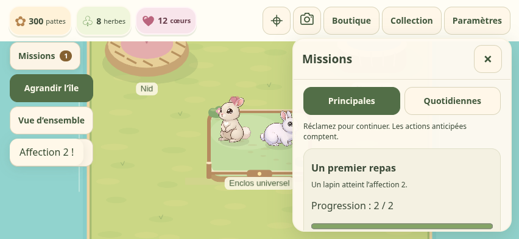
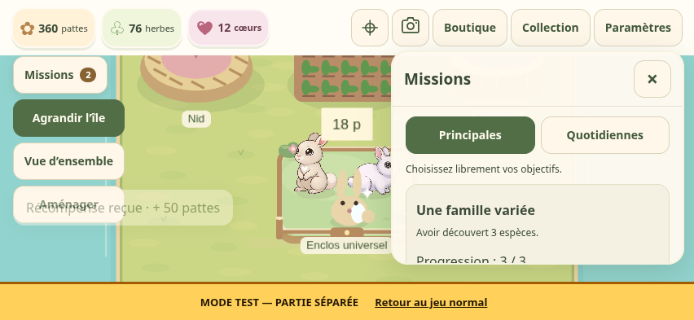
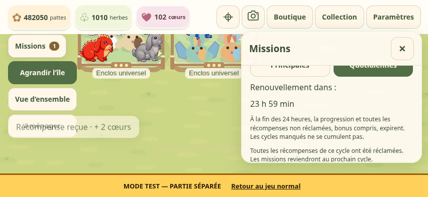

# Missions du début actuel — sauvegardes v8

Cette livraison remplace les principales, sans nouveau tutoriel, aide d’initiation ni changement des prix, délais, revenus, probabilités, illustrations ou caméra. Nid et nurserie sont offerts ; reproduction gratuite et transfert manuel conservés.

## Parcours initial

Un seul objectif est affiché : le premier dont la récompense n’est pas réclamée. Les accomplissements anticipés sont enregistrés indépendamment de cette présentation. Les récompenses nécessitent toujours une réclamation explicite.

| Ordre / identifiant | Objectif | Récompense |
|---|---|---|
| 1 · `first-meal` | Un premier repas : affection 2 | 10 herbes |
| 2 · `first-farm` | Notre ferme : posséder une ferme | 20 herbes |
| 3 · `first-harvest` | Première récolte : récolter 20 herbes | 30 pattes |
| 4 · `parents-ready` | Deux parents prêts : deux lapins d’affection ≥ 2 | 20 pattes |
| 5 · `at-nest` | Au nid : lancer une reproduction | 20 herbes |
| 6 · `to-nursery` | Vers la nurserie : transfert manuel réussi | 30 pattes |
| 7 · `first-birth` | Première naissance : accueil d’un lapereau de reproduction | 50 pattes |

Une fois `first-birth` réclamée, huit objectifs sont proposés en parallèle : collection (3 espèces : 50 pattes ; Brumelin : 1 cœur ; 5 espèces : 2 cœurs), développement (2 habitats : 30 herbes ; Terre : 50 pattes), affection 5 (1 cœur), décoration posée (20 pattes), extension (100 pattes). Aucun ordre imposé entre ces objectifs. Brumelin n’est pas promis ; son raccourci ouvre le carnet. Terre rappelle de préparer un deuxième habitat si le premier est plein. Décoration et expansion sont facultatives.

## Persistance et parties existantes

Les identifiants équivalents restent inchangés : `first-farm`, `varied-family`, `growing-collection`, `strong-bonds`, `bigger-meadow`. Leurs réclamations déjà sauvegardées ne redonnent aucun paiement. `cozy-nest`, `welcome-babies` et `first-rare` sont retirés de la liste active ; leur historique est conservé, leurs anciennes récompenses non réclamées ne sont plus disponibles. `first-rare` n’est pas équivalent à Brumelin : il concernait d’autres espèces.

Possession, découverte et affection sont évaluées depuis l’état vérifiable. Une condition déjà acquise reste enregistrée, même si le lapin ou le bâtiment disparaît ensuite.

Le format reste **v8**, avec l’ajout de `missions.events`, objet borné de cinq compteurs : `collectOrder` (jusqu’à 20 herbes), `breed`, `transferBirth`, `welcome`, `placeDecoration` (jusqu’à une action). Les anciennes sauvegardes sans cet objet sont acceptées avec cinq compteurs à zéro. Aucun occupant, inventaire, résultat, travail, placement ou solde n’est réinitialisé. Un ancien client n’accepte pas les nouveaux identifiants : continuer avec cette livraison après enregistrement.

Seules les actions réussies depuis cette livraison comptent : récolte effective, lancement, transfert manuel, accueil et pose extérieure. Acheter un lapin ne compte jamais comme naissance. Une décoration achetée mais non posée ne compte pas. Les refus, accélérations seules, déplacements de bâtiments, annulations, récompenses et reprises hors ligne ne créent aucun événement. Une reproduction commencée auparavant ne complète pas « Au nid » rétroactivement ; son transfert et son accueil effectués maintenant seront comptés. Même règle pour une récolte d’une production déjà commencée. Les événements antérieurs non enregistrés ne sont pas reconstitués depuis les missions quotidiennes.

Une carte disparaît immédiatement après réclamation ; son identifiant reste dans `claimed`. Les quotidiennes et leur bonus gardent leurs règles, valeurs et cycle de 24 h. Les cartes réclamées sont masquées dans le cycle courant, puis reviennent au renouvellement. Une liste vide affiche un texte discret. Le badge compte uniquement les récompenses visibles et disponibles.

## Validation et laboratoire

Le scénario « Missions — parcours initial et branches » réalise les actions du parcours avec la dotation initiale, sans ajout de ressources. Il conserve les sept récompenses à réclamer et produit Brumelin avec un tirage contrôlé réservé au scénario de laboratoire. Les tests couvrent aussi une naissance commune, les actions anticipées, l’unicité, les sauvegardes v8 sans compteurs et les anciennes réclamations. Les tests quotidiens existants vérifient le renouvellement et le bonus. Le parcours tactile navigateur vérifie les cartes réclamées, rechargement, raccourcis, branches et isolation normal/laboratoire. Le Safari physique reste à tester sur iPhone.

## Essai iPhone

1. Ouvrir Missions : seul « Un premier repas » apparaît ; nourrir un lapin via son raccourci.
2. Réclamer les 10 herbes : la carte disparaît et « Notre ferme » apparaît.
3. Acheter/placer la ferme, puis réclamer sa récompense.
4. Produire et récolter 20 herbes ; réclamer les 30 pattes.
5. Nourrir le deuxième parent jusqu’à 2 et réclamer « Deux parents prêts ».
6. Lancer une reproduction gratuite ; réclamer « Au nid », puis fermer/reprendre le jeu.
7. À la fin du délai, envoyer dans la nurserie et réclamer « Vers la nurserie ».
8. Après croissance, accueillir et réclamer « Première naissance » : huit objectifs indépendants apparaissent. Vérifier le carnet de Brumelin et les quotidiennes ; aucune carte réclamée ne revient avant son renouvellement quotidien.

## Livraison et preuves

Application **ff8966c9d53404d8c160860fd17c6aef11912fc0** : [jeu normal](https://sullivanlegoff-code.github.io/Project-L/) · [laboratoire](https://sullivanlegoff-code.github.io/Project-L/dev/). [PR nº 11](https://github.com/sullivanlegoff-code/Project-L/pull/11) pour les missions, puis correction ciblée du raccourci de nourriture du deuxième parent. Le texte du panneau est compact en paysage ; les objectifs initiaux reviennent en haut après réclamation.

Validation initiale complète : [CI](https://github.com/sullivanlegoff-code/Project-L/actions/runs/38085602454), 658 tests, TypeScript, deux builds, neuf suites tactiles source et dix suites / 36 contrôles des builds. Après la correction ciblée : **659 tests / 22 fichiers**, TypeScript, deux builds locaux et parcours tactile réel avec achat de ferme, production, récolte et nourriture du parent encore sous affection 2. La Paille déjà prête reste à 2 ; le raccourci ouvre Neige. Le test utilise un cœur initial pour accélérer la petite production, sans ajout de ressources.

[Publication finale](https://github.com/sullivanlegoff-code/Project-L/actions/runs/38086664490) : 659 tests, TypeScript, quatre builds, quatre révisions/formats servis confirmés, dix suites / 36 contrôles publics sans erreur. Normal/laboratoire servent `ff8966c` en v8 ; Comptes reste `3e70d9e` en v4, Décorations `85fe255` en v5. Supabase reste en pause.

[Preuve de publication](validation/current-missions/publication.json) · [Rapports publics](validation/current-missions/public-browser.json) · [Contrôle des builds locaux](validation/current-missions/built-missions.json) · [Fichiers graphiques/caméra/règles préservés](validation/current-missions/preserved-scope.json). Les captures ci-dessous proviennent du build local final ; les captures du site réel sont dans l’artefact de publication. Contrôles réalisés avec Chromium tactile ; Safari physique reste à tester sur iPhone.

